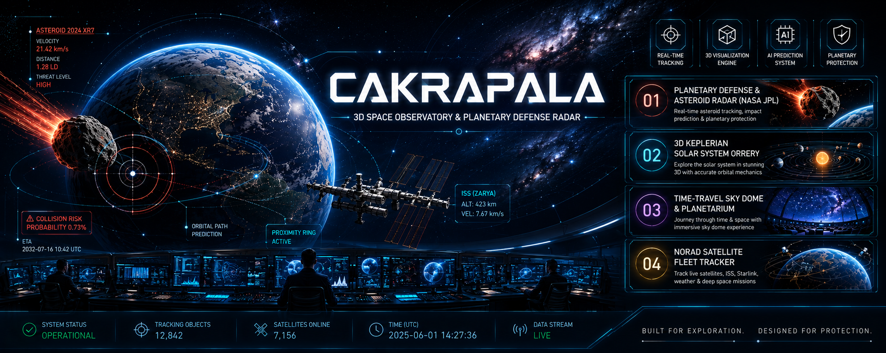

# 🌌 Cakrapala — 3D Aerospace Space Observatory & Planetary Defense Radar

<p align="center">
  <a href="https://cakrapala.vercel.app"><strong>🚀 Launch Live Observatory</strong></a>
  ·
  <a href="https://cakrapala.vercel.app/osint"><strong>🌍 GEOSINT (Earth Intelligence)</strong></a>
  ·
  <a href="https://github.com/tyobramas/cakrapala"><strong>⭐ Star the Project</strong></a>
</p>

<p align="center">
  
  
  
  
  
</p>



> **An interactive, AI-augmented 3D space observatory and real-time planetary defense cockpit transforming raw NASA, NORAD, and IAU telemetry into intuitive spatial intelligence.**

> **From tracking near-Earth asteroids and orbital satellites to exploring 3D constellation domes and planetary orbits—Cakrapala turns complex space telemetry into an interactive spatial intelligence experience directly in your browser.**

### ✨ Explore the Universe

- ☄️ Inspect real-world near-Earth asteroid approaches
- 🛰️ Track orbital assets over an interactive 3D Earth
- 🌍 Monitor real-time global situation & Earth Intelligence telemetry (GEOSINT)
- 🌠 Explore 9,110+ stars and 85 dynamically mapped constellation artworks
- 🪐 Navigate a heliocentric Solar System orrery
- 🤖 Interact with an AI astronomy and astrophysics co-pilot

---

## 🎯 Selected Challenge Theme

**August Challenge — Advance Space Exploration with AI.**
Cakrapala targets the gap between authoritative space data (NASA NeoWs,
CelesTrak/NORAD TLE, IAU/Hipparcos catalogues) and the general public's
ability to interpret it, by turning raw telemetry into a spatially accurate,
interactive observatory with an AI explanation layer on top.

## 🛠️ How IBM Bob Was Used

IBM Bob was the primary development tool for this project, from problem
framing through implementation:

**Business process & product definition**
- Shaping the problem statement: identifying who actually suffers from
  inaccessible space telemetry (students, educators, science communicators,
  amateur observers) and what decision each of them needs to make.
- Defining the five-module scope and the user journey through them, and
  deciding what belongs in a deterministic solver versus an AI explanation
  layer.
- Prioritising features against real-world feasibility — what a browser can
  honestly deliver without proprietary desktop tooling such as STK or GMAT.

**Fundamental coding**
- Establishing the Next.js 16 App Router structure and the domain boundaries
  between `lib/astronomy`, `lib/satellites`, and the render components.
- Writing the core physics and spherical-astronomy routines: the topocentric
  RA/Dec → horizon pipeline, Keplerian planetary orbits, and SGP4 orbital
  propagation.
- Establishing TypeScript contracts and unit conventions (SI internally,
  display conversion at the boundary) so modules compose without silent
  unit errors.

**Building and hardening the application**
- Implementing the 3D render layers across Three.js, CesiumJS, and Babylon.js.
- Diagnosing the constellation artwork misalignment, replacing hand-measured
  UV anchors with an authoritative generated set, and designing the gnomonic
  tangent-plane affine solver behind it.
- Authoring the Vitest suites that validate handedness, shear, anisotropy,
  and residuals across all 85 anchored constellations.
- Performance and security review: eliminating per-frame GPU geometry
  reallocation in the sky renderer, and enforcing server-side-only secrets
  handling in the AI route.

---

## 🎯 1. Problem Statement

Despite billions of dollars invested in global space exploration and orbital infrastructure, scientific literacy and planetary defense face critical visualization and comprehension barriers:

1. **Space Disinformation & Sensationalism**: Mainstream media frequently publishes alarmist headlines regarding Near-Earth Asteroids (NEOs). The public lacks an accessible, verified radar to independently inspect true miss distances (in Lunar Distances), orbital trajectories, and Torino impact risk scales in real time.
2. **Abstract Astrophysics & STEM Education Barriers**: Fundamental celestial mechanics concepts—such as Keplerian elliptical orbits, topocentric coordinates, sidereal time, and satellite orbital regimes—are difficult to grasp through 2D textbook diagrams and equations without interactive spatial 3D simulation.

---

## 💡 2. Solution Description

**Cakrapala** is a browser-native, WebGL-powered 3D space observatory and celestial exploration platform that delivers real-time astronomical intelligence through integrated modules:

* **Real-Time Near-Earth Object (NEO) Radar**: Live tracking of asteroids ingested directly from NASA JPL NeoWs, displaying close-approach velocity, minimum miss distance, DEFCON threat status, and intuitive real-world physical size comparisons (e.g., Monas, Eiffel Tower, Boeing 747).
* **Multi-Satellite Fleet Orbit Tracker**: High-precision SGP4 propagation of active space assets (ISS, Tiangong CSS, Hubble Space Telescope, NOAA-19, Terra, Starlink) over CesiumJS 3D geospatial globes.
* **Topocentric Ground Sky Observatory**: Stellarium-style interactive sky view from any observer coordinate on Earth, rendering 9,110 stars from the Yale Bright Star Catalog (BSC5) and 85 constellation artworks anchored to real sky coordinates via a gnomonic tangent-plane affine solver.
* **Heliocentric 3D Solar System Orrery**: Multi-body Keplerian planetary simulator modeling orbital periods, eccentricities, and semi-major axes across all 8 major solar system planets.
* **Universal Space Codex**: Interactive astrophysics encyclopedia with certified IAU definitions and integrated SYS-AI terminal queries.

---

## 🌌 3. Domain Focus & Mission Scope

* **Core Focus**: **AI for Science, Space Exploration & Open Data Innovation**
* **Strategic Pillars**:
  * **Open Scientific Data Utility**: Transforms complex, raw scientific APIs (NASA Open Data, NASA Horizons, CelesTrak NORAD, IAU) into high-impact public safety intelligence.
  * **Human-Centered STEM Visualization**: Replaces overwhelming raw data spreadsheets with intuitive 3D graphics, orbital path visualizations, and physical scale comparisons.
  * **Universal Web Accessibility**: Operates natively in any modern web browser via WebGL/WebAudio with zero installation barriers or hardware dependencies.

---

## 🤖 4. AI Approach & Technical Architecture

```
┌────────────────────────────────────────────────────────────────────────────────┐
│                        CAKRAPALA AI & SYSTEM ARCHITECTURE                      │
└────────────────────────────────────────────────────────────────────────────────┘
                                        │
    ┌───────────────────────────────────┼───────────────────────────────────┐
    ▼                                   ▼                                   ▼
┌───────────────────────┐   ┌───────────────────────────────────┐   ┌───────────────────────────────────┐
│   DATA INGESTION      │   │     DETERMINISTIC SOLVER CORE     │   │         AI CO-PILOT LAYER         │
│  • NASA JPL NeoWs API │   │  • astronomy-engine · satellite.js│   │  • Provider-agnostic LLM          │
│  • CelesTrak TLEs     │   │  • Custom Astrometry & Orbits     │   │    (Server-side, streaming)      │
│  • IAU Star Catalog   │   │  • SGP4 · Keplerian Propagator    │   │  • Structured Context Grounding   │
└───────────┬───────────┘   └─────────────────┬─────────────────┘   └─────────────────┬─────────────────┘
            │                                 │                                       │
            │                                 └─── ↕ structured context only ─────────┘
            └─────────────────────────────────┬───────────────────────────────────────┘
                                              ▼
    ┌───────────────────────────────────────────────────────────────────┐
    │          3D SPATIAL ENGINE (Three.js, CesiumJS & Babylon.js)       │
    │  • Geospatial Satellite Globe (CesiumJS WGS-84 & Orbit Ground Track)│
    │  • Topocentric Sky Dome (Three.js Yale BSC5 & 85 Constellations)  │
    │  • 3D Asteroid Hazard Radar (Three.js Proximity & Scale Ruler)    │
    │  • Heliocentric Planetary Orrery (Babylon.js Keplerian System)    │
    └───────────────────────────────────────────────────────────────────┘
```

### 🤖 AI Space Co-Pilot
An LLM-backed conversational layer grounded on Cakrapala's deterministic
astronomy and astrodynamics engines. The model never invents numbers: every
orbital, ephemeris, and Δv figure quoted in a response is computed first by
the solver core, then passed to the model as structured context.

1. **Astrophysical Grounding**: Automated synthesis of celestial telemetry, orbital regimes, and astronomical definitions.
2. **Deterministic Physics Gatekeeper**: Orbital passes and planetary coordinates are verified by astronomical engines before 3D rendering to ensure mathematical precision.

---

## 📊 5. Evaluation Points & Capability Matrix

| Evaluation Dimension | Technical Implementation & Architectural Evidence |
| :--- | :--- |
| **Technical Execution & Reliability** | • **Full-Stack Excellence**: Built on Next.js 16 (App Router), React 19, and strict TypeScript.<br>• **Multi-Engine 3D Graphics**: Three.js (Asteroid Radar & Ground Sky), CesiumJS (Satellite Fleets), and Babylon.js (Planetary Orrery).<br>• **Rigorous Closed-Form Astrometry**: Vis-Viva orbital speed, SGP4 satellite propagation, and Gnomonic Tangent-Plane Affine Solvers.<br>• **High Reliability**: 49 unit tests across 12 suites — 100% passing and 100% successful Next.js production builds. |
| **Innovation & Spatial Intelligence** | • **Spatial 3D Intelligence**: Immersive 3D environments for planetary defense, ground sky dome observation, and real-time orbital fleet visualization.<br>• **Human-Scale Scale Comparisons**: Compares asteroid dimensions to tangible landmarks (Monas 132m, Eiffel Tower 330m, Boeing 747 70m).<br>• **Gnomonic Tangent-Plane Affine Solver**: Resolves celestial artwork distortion dynamically from Hipparcos catalogue coordinates. |
| **Domain Scope & Open Data Alignment** | • **100% Aligned with Open Science Data**: Directly ingests open scientific data from NASA JPL NeoWs, NASA Horizons, NORAD/CelesTrak TLEs, and the Yale Bright Star Catalog (BSC5).<br>• **Scientific Rigor**: Merges generative AI insights with deterministic physical constraints. |
| **Feasibility & Operational Deployment** | • **100% Browser-Native & Zero-Install**: Accessible globally without requiring specialized desktop software licenses or proprietary GPU hardware.<br>• **Optimized Performance**: Server-side API caching, asset pre-generation, and disciplined WebGL memory management. |
| **Real-World Impact & Public Value** | • **Mitigating Media Panic & Disinformation**: Delivers a transparent, zero-bias visual radar for asteroid close-approaches to counter sensationalist media claims.<br>• **Democratizing Astronomy Education**: Empowers students, educators, and stargazers worldwide to explore the cosmos and track space infrastructure interactively for free. |

---

## 🚀 Key Modules (System Cockpit)

| Module Code | Module Name | Core Technology | Primary Functionality |
| :--- | :--- | :--- | :--- |
| **SYS-01** | **3D Planetary Orrery** | Babylon.js & Keplerian Math | Heliocentric simulation of 8 primary solar system planets. |
| **SYS-02** | **Ground Sky Observatory** | Three.js, BSC5 & Hipparcos | Topocentric Stellarium-style ground sky dome with 9,110 stars & 85 affine-projected constellation artworks. |
| **SYS-03** | **Asteroid Defense Radar** | NASA JPL NeoWs & Three.js | Real-time NEO proximity radar, DEFCON threat monitoring, and physical size scaling. |
| **SYS-04** | **Satellite Fleet Radar** | SGP4 Propagator & CesiumJS | Live multi-satellite tracking with ground tracks and sensor footprint cones. |
| **SYS-05** | **Universal Space Codex** | Next.js & IAU Lexicon | Interactive astrophysics encyclopedia with certified IAU definitions and formulas. |
| **SYS-06** | **GEOSINT (Earth Intelligence)** | CesiumJS 3D Globe | 7-layer global situational awareness: earthquakes, wildfires, tropical cyclones, air traffic (ADS-B), sea traffic (AIS), public webcams, and NASA GIBS imagery. |

---

### 🌍 GEOSINT — Earth Intelligence & Situational Awareness (`/osint`)
- **7 Integrated Situational Layers**: Real-time monitoring of USGS earthquakes, NASA FIRMS thermal hotspots, NOAA NHC/GDACS tropical storms, adsb.lol crowdsourced flight tracking, Fintraffic marine AIS vessel tracking, public/traffic webcams, and daily NASA EOSDIS GIBS basemaps.
- **Interactive 3D Geospatial Engine**: Rendered on CesiumJS with camera altitude zoom-gating (`aggregate`, `icons`, `detail`), dead reckoning movement, and strict license & ethical compliance (no individual tracking, view-only, zero background polling for webcams).
- **Comprehensive Attribution & Ethics Page** at `/osint/sumber` documenting data providers, licenses, and takedown procedures.

### 🌠 Ground Sky Observatory (`/sky`)
- **9,110 stars** from the Yale Bright Star Catalogue, plotted topocentrically
  from observer latitude/longitude and Local Sidereal Time.
- **85 constellation artworks** anchored to real sky coordinates. Anchor stars
  are resolved from the Hipparcos catalogue (CDS VizieR I/239) rather than
  measured by hand, and each artwork is mapped through a **gnomonic
  tangent-plane affine solver** — so orientation, aspect ratio, and parallactic
  tilt follow the sky correctly at any latitude and any time, with no
  hard-coded rotation constants.
- **Validated, not eyeballed.** An automated audit asserts consistent
  handedness (negative Jacobian determinant) across all 85 constellations,
  plus bounded shear and aspect-ratio anisotropy.
- Argo Navis (Carina/Puppis/Vela) is rendered as a single historical figure,
  matching Stellarium's Western sky-culture convention.

---

## 🛠️ Tech Stack

* **AI & Engineering Platform**: **IBM Bob** (Development & Architecture Copilot) + **AI Co-Pilot Layer** (Provider-agnostic LLM with deterministic physics grounding)
* **Framework**: [Next.js 16 (App Router)](https://nextjs.org/) + [React 19](https://react.dev/) + [TypeScript](https://www.typescriptlang.org/)
* **3D & Geospatial Engines**: [Three.js](https://threejs.org/) + [CesiumJS](https://cesium.com/) + [Babylon.js](https://www.babylonjs.com/)
* **Astrophysics Math**: `astronomy-engine`, `satellite.js` (SGP4), WGS-84 Ellipsoid Transforms, Gnomonic Affine Solvers
* **Styling & UI**: Tailwind CSS + Lucide Icons + Frosted Sci-Fi Glassmorphism
* **Data Sources**: NASA JPL NeoWs, NASA Horizons, CelesTrak NORAD, Yale Bright Star Catalog (BSC5), ESA Hipparcos (CDS VizieR I/239)

---

## 🗺️ Roadmap

- **Tactical Voice HUD** *(experimental — not enabled in this release)*: Hands-free voice recognition and speech telemetry feedback for cockpit operations.
- **Deep Space Object Ephemeris Expansion**: Enhanced catalog tracking for deep-sky Messier and Caldwell objects.
- **Expanded Constellation Mythology**: Multi-culture sky-lore overlays (Arabic, Chinese, and Polynesian celestial traditions).

---

## 💻 Getting Started

### Prerequisites

* Node.js 20.9.0 or newer
* npm, pnpm, or yarn
* A modern browser with WebGL support

### Installation

```bash
# Clone repository
git clone https://github.com/tyobramas/cakrapala.git
cd cakrapala

# Install dependencies
npm install

# Create local environment configuration
cp .env.local.example .env.local

# Run automated tests
npm test

# Run development server
npm run dev
```

For Windows Command Prompt, create the environment file with:

```bat
copy .env.local.example .env.local
```

Configure the required credentials inside `.env.local`:

```env
# NASA JPL API
NASA_API_KEY=your_nasa_api_key_here

# Cesium ion
NEXT_PUBLIC_CESIUM_ION_TOKEN=your_cesium_token_here

# AI Router
NARA_ROUTER_BASE_URL=https://router.bynara.id/v1
NARA_ROUTER_API_KEY=your_nara_api_key_here
NARA_ROUTER_MODEL=agnes-2.5-flash
```

> [!IMPORTANT]
> Never commit `.env.local` or expose server-side API keys in client-side code. Variables prefixed with `NEXT_PUBLIC_` are included in the browser bundle.

Open [http://localhost:3000](http://localhost:3000) with your browser. Navigate to [http://localhost:3000/osint](http://localhost:3000/osint) to access **GEOSINT (Earth Intelligence)**.


### Available Commands

```bash
# Start development server
npm run dev

# Run automated tests (49 unit tests across 12 suites)
npm test

# Run TypeScript validation
npx tsc --noEmit

# Create a production build
npm run build

# Start the production server
npm start
```

---

## 📜 License

Source code: MIT License (see `LICENSE`).
Constellation artwork: Free Art License 1.3 — © Johan Meuris, Stellarium
project. Anchor coordinate data derived from Stellarium (GPLv2+). Star
positions from the ESA Hipparcos catalogue via CDS VizieR. Full attribution
in `ASSET_SOURCES.md`.
