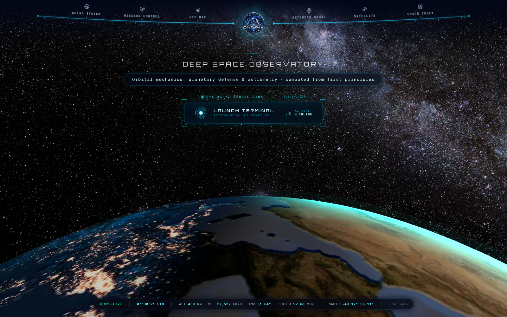
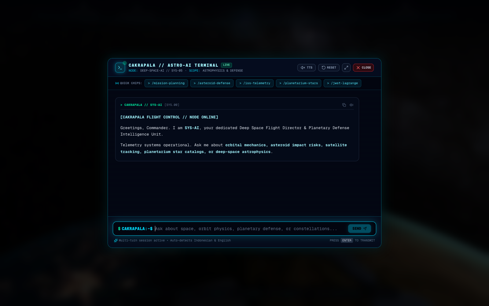
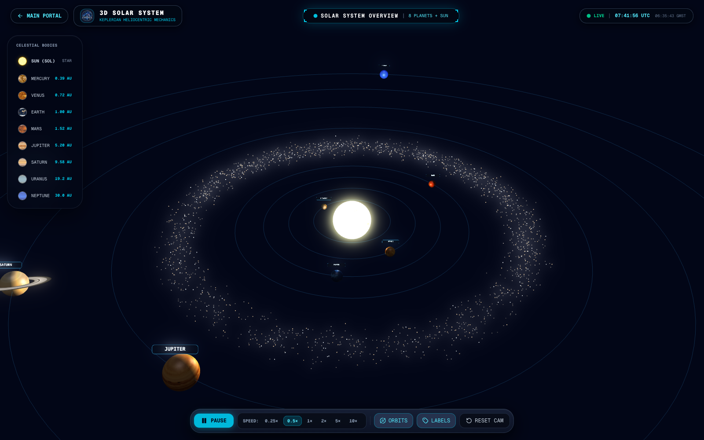
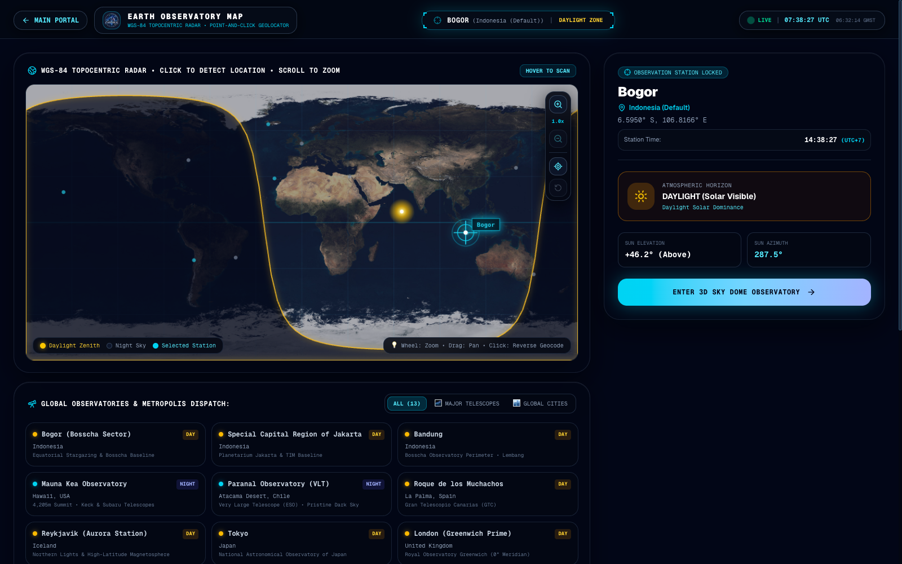
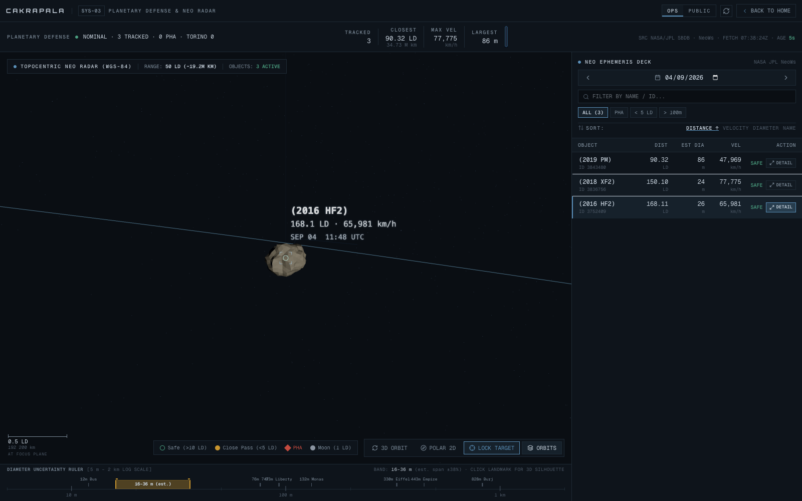
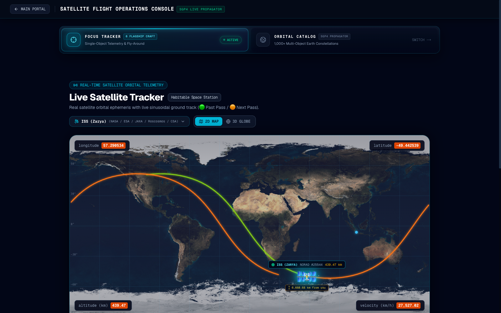
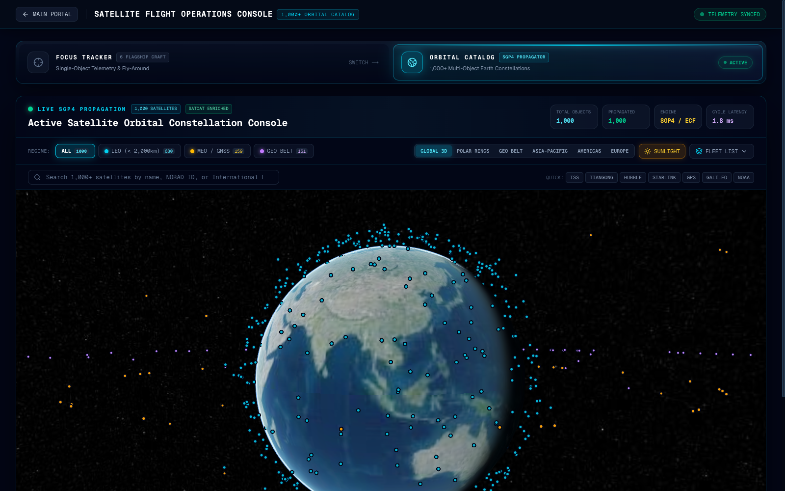
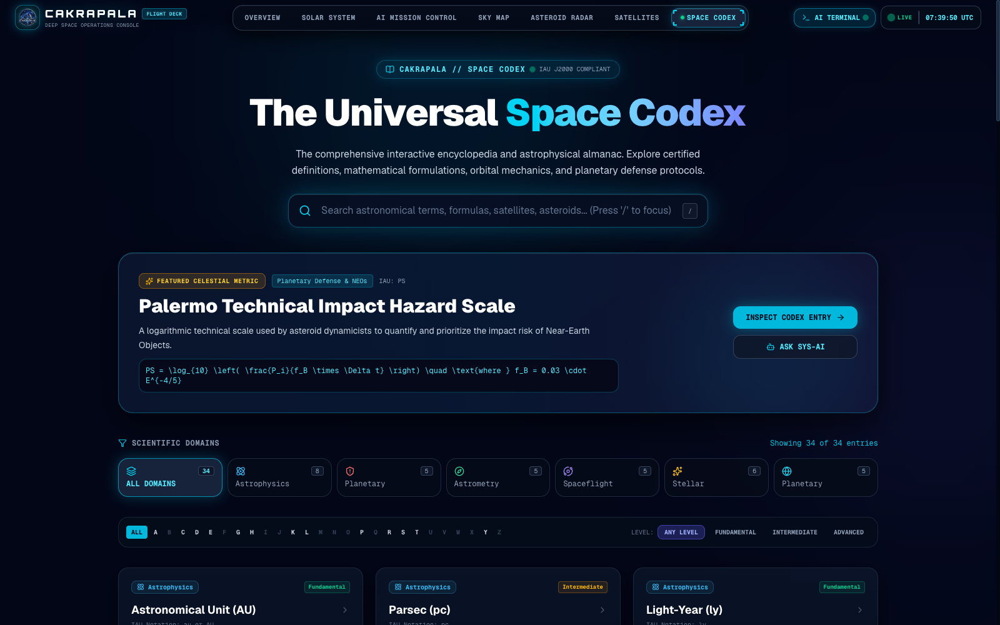

# BUKU PANDUAN PENGGUNAAN PROGRAM KOMPUTER (MANUAL BOOK) & URAIAN CIPTAAN RESMI

### KEMENTERIAN HUKUM DAN HAK ASASI MANUSIA REPUBLIK INDONESIA
**DIREKTORAT JENDERAL KEKAYAAN INTELEKTUAL (DJKI)**  
*Dokumen Persyaratan Substantif Permohonan Pendaftaran Hak Cipta atas Program Komputer*

---

## CAKRAPALA — DEEP SPACE OBSERVATORY & ASTRO-AI CO-PILOT
**Platform Observatorium Digital, Astrometri Toposentrik, dan Radar Pertahanan Planet Berbasis Web 3D**  
**Tautan Akses Resmi:** [https://cakrapala.com](https://cakrapala.com)

---

### TABEL METADATA DAN BIBLIOGRAFI CIPTAAN

| Parameter Ciptaan | Keterangan Data Teknis Resmi |
| :--- | :--- |
| **Judul Ciptaan** | Cakrapala — Deep Space Observatory & Astro-AI Co-Pilot |
| **Jenis Ciptaan** | Program Komputer (Aplikasi Web / Software-as-a-Service) |
| **Tautan Akses Resmi (URL)** | [https://cakrapala.com](https://cakrapala.com) |
| **Bahasa Pemrograman** | TypeScript, JavaScript (ECMAScript 2024), GLSL (OpenGL Shading Language) |
| **Framework & Engine Grafis** | Next.js 16 (React 19), Three.js (WebGL 2.0), Tailwind CSS, CesiumJS |
| **Algoritma Astrodinamika** | SGP4/SDP4 Satellite Perturbation Model, NASA NeoWs Harvester, Keplerian Mechanics J2000.0 |
| **Tahun Pertama Diumumkan** | 2026 |
| **Negara Pertama Diumumkan** | Indonesia |

---

## BAB 1: IDENTITAS DAN INFORMASI UMUM CIPTAAN

Buku Panduan Manual Penggunaan Program Komputer (*Manual Book*) ini disusun secara komprehensif sebagai dokumen operasional teknis dan pemenuhan syarat substantif pendaftaran Hak Cipta atas Program Komputer pada Direktorat Jenderal Kekayaan Intelektual (DJKI), Kementerian Hukum dan Hak Asasi Manusia Republik Indonesia.

**Cakrapala** adalah karya cipta perangkat lunak berwujud program komputer berbasis web interaktif (*Web-Based Application / SaaS*) yang diakses daring melalui alamat resmi [https://cakrapala.com](https://cakrapala.com). Program ini menyatukan komputasi astrodinamika orbital, simulasi grafis 3D WebGL fotorealistik, propagasi satelit real-time SGP4, radar pendeteksi asteroid *Near-Earth Object* (NEO) NASA JPL, serta asisten kecerdasan buatan (*Astro-AI Co-Pilot*) dalam satu antarmuka terpadu bergaya kokpit kedirgantaraan (*Aerospace HUD*).

---

## BAB 2: LATAR BELAKANG PENCIPTAAN DAN TUJUAN INOVASI

### 2.1. Latar Belakang Masalah
Penciptaan perangkat lunak Cakrapala berakar pada tiga permasalahan mendasar dalam ekosistem sains antariksa dan literasi publik:
1. **Bahaya Misinformasi dan Hoaks Asteroid:** Media massa daring kerap mempublikasikan potensi papasan asteroid dengan tajuk sensasional dan bombastis yang memicu kecemasan publik. Ketiadaan radar primer terbuka menyebabkan masyarakat kesulitan memverifikasi jarak dan risiko nyata secara ilmiah.
2. **Tingginya Hambatan Pemahaman Data Mentah Antariksa:** Data orbit satelit dan koordinat ephemeris benda langit yang dirilis oleh NASA JPL dan NORAD disajikan dalam bentuk deret angka TLE (*Two-Line Element*) dan tabel numerik yang sangat teknis dan rumit.
3. **Fragmentasi Software Astronomi Konvensional:** Aplikasi astronomi di pasar umumnya terpisah-pisah (hanya sebatas peta bintang darat 2D atau kalkulator orbit terisolasi), tanpa adanya kokpit visualisasi terpadu multi-skala yang menghubungkan orbit rendah bumi (LEO), tata surya heliosentris, dan radar ancaman asteroid.

### 2.2. Deskripsi dan Tujuan Inovasi Ciptaan
Cakrapala memecahkan seluruh kendala tersebut dengan menghadirkan kokpit luar angkasa digital berbasis web dengan tujuan:
- Menyediakan simulasi 3D real-time berbasis WebGL/Three.js yang ringan dan dapat diakses langsung dari browser tanpa instalasi.
- Menghitung propagasi lintasan orbit ISS dan ribuan satelit buatan secara presisi menggunakan model matematika SGP4/SDP4.
- Mendemokratisasi data bahaya asteroid NASA NeoWs dengan diagram radar cincin jarak Bulan (*Lunar Distance*) dan analogi skala ukuran fisik nyata (Monas, Stadion GBK, Menara Eiffel).
- Menghadirkan asisten kecerdasan buatan (*SYS-AI Astro-Terminal*) untuk memandu pengguna dalam memahami konsep astrofisika.

---

## BAB 3: SPESIFIKASI TEKNIS DAN ARSITEKTUR PERANGKAT LUNAK

- **Bahasa Pemrograman:** TypeScript 5.x, JavaScript (ES2024), GLSL (*Custom Shaders*).
- **Framework Aplikasi:** Next.js 16 (React 19 Server/Client Components) dengan App Router Architecture.
- **Engine Grafis 3D:** Three.js (WebGL 2.0) dengan Rayleigh scattering atmosferik dan pencahayaan terminator siang/malam dinamis, serta CesiumJS.
- **Algoritma Komputasi:** `satellite.js` (SGP4/SDP4 perturbation propagator) dan model orbital Keplerian J2000.0.
- **Integrasi Data Primer:** NASA JPL NeoWs API, Space-Track/CelesTrak TLE Catalog, Yale Bright Star Catalog (BSC5 - 2.800+ bintang).

### Kebutuhan Sistem Pengguna:
- Perangkat: Komputer, Laptop, Tablet, atau Smartphone.
- Peramban Web: Google Chrome, Mozilla Firefox, Apple Safari, Microsoft Edge.
- Koneksi Internet: Minimal 2 Mbps.
- Memori RAM: Minimal 4 GB (Disarankan 8 GB).

---

## BAB 4: PANDUAN AKSES DARING (CAKRAPALA.COM)

Program Cakrapala dirilis dengan arsitektur cloud *Zero-Installation*. Pengguna dan tim pemeriksa DJKI tidak memerlukan instalasi perangkat lunak atau konfigurasi apapun pada komputer:
1. **Langkah 1 (Persiapan):** Pastikan perangkat komputer atau ponsel telah menyala dan terhubung ke jaringan internet.
2. **Langkah 2 (Buka Browser):** Jalankan aplikasi peramban web (Chrome, Firefox, Safari, atau Edge).
3. **Langkah 3 (Ketik Alamat URL):** Pada bilah alamat browser, ketikkan alamat: `https://cakrapala.com` lalu tekan Enter.
4. **Langkah 4 (Inisialisasi Otomatis):** Sistem akan secara instan memuat antarmuka kokpit observatorium antariksa 3D, simulasi rotasi Bumi vertikal, dan galaksi Bima Sakti secara otomatis.

---

## BAB 5: PANDUAN LENGKAP PENGOPERASIAN SEMUA MENU BESERTA SCREENSHOT NYATA

Aplikasi Cakrapala tersusun atas 8 modul antarmuka utama yang saling terintegrasi. Berikut penjelasan mendalam setiap modul:

---

### 5.1. Modul 1: Landing Page & Kokpit Dirgantara LEO (Overview Deck — '/')

Gerbang utama sistem yang menyajikan pemandangan LEO (*Low Earth Orbit*) beresolusi tinggi langsung dari jendela observasi wahana antariksa.


*Gambar 5.1: Tampilan Antarmuka Landing Page & Kokpit Dirgantara LEO (cakrapala.com)*

#### A. Penjelasan Elemen Antarmuka (UI Breakdown):
1. **Curved NavbarArc:** Rel navigasi melengkung matematis (*parabola sag*) di bagian atas monitor desktop yang memuat stasiun navigasi utama. Stasiun aktif disorot dengan pendaran warna cyan laser.
2. **Viewport 3D Bumi LEO & Bima Sakti:** Bola dunia 3D fotorealistik yang berputar secara vertikal ke bawah, mensimulasikan laju maju wahana antariksa mengitari Bumi. Latar belakang menampilkan galaksi Bima Sakti dengan kemiringan diagonal estetik (~30°).
3. **Banner Identitas & Tagline:** Logo resmi Cakrapala dengan tagline *"Orbital mechanics, planetary defense & astrometry · computed from first principles"*.
4. **Launcher SYS-AI // NEURAL LINK:** Tombol futuristik ber-retikel target aktif di tengah layar untuk membuka asisten AI.
5. **Bilah Telemetri Waktu Nyata (Bottom Telemetry Strip):** Bilah kaca transparan di bagian bawah yang menyajikan data primer telemetri ISS: Status (SYS-LIVE), Jam UTC, Ketinggian Orbit (ALT ~439 KM), Kecepatan Laju (VEL 27.528 KM/H), Sudut Inklinasi (INC 51.64°), Periode Orbit (92.68 MIN), dan Koordinat Nadir Bumi.

#### B. Panduan Langkah Pengoperasian:
- **Langkah 1:** Buka `https://cakrapala.com` pada browser web.
- **Langkah 2:** Amati bilah telemetri di bagian bawah untuk melihat koordinat lintang/bujur dan ketinggian orbit satelit ISS yang diperbarui secara langsung.
- **Langkah 3:** Pilih menu stasiun eksplorasi pada bilah navigasi lengkung di bagian atas.
- **Langkah 4:** Klik tombol *"LAUNCH TERMINAL"* untuk memunculkan modal percakapan AI.

---

### 5.2. Modul 2: Asisten AI Antariksa (SYS-AI Astro-Terminal Modal)

Asisten kecerdasan buatan interaktif yang bertindak sebagai *Flight Director & Planetary Defense Intelligence Unit* untuk konsultasi ilmiah astrofisika dan mekanika orbital.


*Gambar 5.2: Tampilan Antarmuka Asisten AI Antariksa (SYS-AI Astro-Terminal)*

#### A. Penjelasan Elemen Antarmuka (UI Breakdown):
1. **Header Kontrol Terminal:** Bingkai dialog bergaya CRT sci-fi retro-futuristik dengan indikator status `[NODE ONLINE]`, tombol TTS (*Text-to-Speech*), Reset Session Buffer, Maximize Screen, dan Close Window.
2. **Bilah Perintah Cepat (Quick Chips):** Tombol pintasan untuk menanyakan topik populer secara instan (`> /orbital-mechanics`, `> /asteroid-defense`, `> /iss-telemetry`, `> /planetarium-stars`, `> /jwst-lagrange`).
3. **Konsol Dialog Percakapan:** Area output yang menampilkan teks respon AI dengan efek animasi mesin ketik (*typewriter*), pemformatan Markdown matematis, tombol salin ke clipboard, dan tombol audio TTS.
4. **Input Box Command Line:** Bilah input perintah dengan prompt terminal Linux kedirgantaraan (`$ CAKRAPALA:~$`), tombol *"SEND"*, serta kemampuan memahami bahasa Indonesia dan Inggris secara bilingual.

#### B. Panduan Langkah Pengoperasian:
- **Langkah 1:** Klik tombol *"LAUNCH TERMINAL"* pada landing page atau logo Cakrapala pada navbar.
- **Langkah 2:** Pilih salah satu chip perintah cepat atau ketik pertanyaan langsung pada kotak teks (misal: *"Bagaimana cara ISS mempertahankan ketinggian orbitnya?"*).
- **Langkah 3:** Tekan Enter atau klik *"SEND"*. Respon ilmiah akan diketikkan secara real-time.
- **Langkah 4:** Klik ikon speaker untuk mendengarkan sintesis suara AI atau ikon copy untuk menyalin penjelasan.

---

### 5.3. Modul 3: Simulator Tata Surya 3D (Planetary Orrery — '/solar-system')

Modul orrery tata surya 3D matematis yang memodelkan pergerakan revolusi heliosentris Matahari dan 8 planet utama berdasarkan mekanika Keplerian J2000.0.


*Gambar 5.3: Tampilan Antarmuka Simulator Tata Surya 3D Heliosentris*

#### A. Penjelasan Elemen Antarmuka (UI Breakdown):
1. **Viewport 3D Heliosentris:** Kanvas WebGL Three.js dengan Matahari bercahaya di pusat, lintasan garis orbit elips setiap planet, serta sebaran partikel sabuk asteroid utama (*Main Asteroid Belt*).
2. **Panel Benda Langit (Celestial Bodies):** Daftar planet di sisi kiri (Merkurius hingga Neptunus) lengkap dengan jarak rata-rata dalam satuan *Astronomical Unit* (AU).
3. **Bilah Kontrol Waktu & Visual:** Slider kecepatan revolusi (Speed 0.25x - 10x), tombol jeda (PAUSE/PLAY), toggle penampil garis orbit (ORBITS), penampil label nama (LABELS), dan reset kamera (RESET CAM).

#### B. Panduan Langkah Pengoperasian:
- **Langkah 1:** Klik menu *"SOLAR SYSTEM"* pada bilah navigasi atau kunjungi `https://cakrapala.com/solar-system`.
- **Langkah 2:** Klik kiri dan tahan kursor untuk merotasi sudut pandang 360 derajat. Gunakan scroll wheel mouse untuk memperbesar/memperkecil jarak pandang.
- **Langkah 3:** Klik nama salah satu planet pada daftar sisi kiri untuk mengunci bidikan kamera (*Auto-Tracking*).
- **Langkah 4:** Atur bilah kecepatan waktu untuk mengamati simulasi peredaran revolusi planet secara dinamis.

---

### 5.4. Modul 4: Peta Langit & Planetarium Toposentrik (Sky Map — '/sky')

Modul observatorium langit malam toposentrik berbasis darat yang menyajikan proyeksi kubah langit akurat sesuai garis lintang dan bujur pengamat di permukaan Bumi.


*Gambar 5.4: Tampilan Antarmuka Peta Langit & Radar Toposentrik WGS-84*

#### A. Penjelasan Elemen Antarmuka (UI Breakdown):
1. **Radar Toposentrik WGS-84:** Peta dunia proyeksi datar interaktif yang menampilkan kurva batas siang/malam (*Day/Night Terminator*), titik zenith Matahari, dan bidikan stasiun observasi aktif.
2. **Kartu Stasiun Observasi:** Menampilkan nama stasiun (misal: Bogor Indonesia 6.5950° S, 106.8166° E), waktu lokal, status atmosfer (DAYLIGHT / NIGHT), serta sudut elevasi dan azimuth Matahari.
3. **Katalog Stasiun Global & Metropolis:** Daftar tombol observatorium dunia (Observatorium Bosscha Lembang, Planetarium Jakarta, Mauna Kea Hawaii, Paranal Chili, Roque de los Muchachos Spanyol, Tokyo, London Greenwich).
4. **Tombol Peluncur Kubah Langit 3D:** Tombol *"ENTER 3D SKY DOME OBSERVATORY"* untuk membuka simulasi kubah langit malam dengan 2.800+ bintang Yale BSC5 dan 89 rasi bintang IAU.

#### B. Panduan Langkah Pengoperasian:
- **Langkah 1:** Klik menu *"SKY MAP"* pada bilah navigasi atau kunjungi `https://cakrapala.com/sky`.
- **Langkah 2:** Pilih stasiun pengamatan yang diinginkan (misal *"Bogor (Bosscha Sector)"*).
- **Langkah 3:** Periksa kartu stasiun di sebelah kanan untuk melihat sudut elevasi dan posisi Matahari saat ini.
- **Langkah 4:** Klik tombol *"ENTER 3D SKY DOME OBSERVATORY"* untuk masuk ke mode kubah bintang 3D interaktif.

---

### 5.5. Modul 5: Radar Asteroid & Pertahanan Planet (NEO Radar — '/explore')

Modul pusat pemantauan asteroid mendekati Bumi (*Near-Earth Objects / NEO*) yang terhubung langsung dengan basis data telemetri primer NASA Jet Propulsion Laboratory (JPL).


*Gambar 5.5: Tampilan Antarmuka Radar Asteroid & Pertahanan Planet NASA JPL*

#### A. Penjelasan Elemen Antarmuka (UI Breakdown):
1. **Viewport Radar 3D Interaktif:** Kanvas 3D yang memvisualisasikan model fisik asteroid, garis trajektori lintasannya, dan retikel pelacak otomatis yang mengunci sasaran.
2. **NEO Ephemeris Deck:** Tabel daftar asteroid mendekati Bumi pada tanggal terpilih, memuat ID Asteroid, Jarak (*Lunar Distance* / LD), Estimasi Diameter (meter), Kecepatan (km/jam), dan Status Keamanan (SAFE / PHA).
3. **Penggaris Ketidakpastian Diameter (Diameter Uncertainty Ruler):** Skala visual di dasar layar yang menyandingkan ukuran asteroid terhadap bangunan ikonik dunia nyata: Bus Kota (12m), Patung Liberty (76m), Stadion GBK (105m), Monas Jakarta (132m), Menara Eiffel (330m), Empire State (443m), dan Burj Khalifa (828m).
4. **Header Status Pertahanan Planet:** Menampilkan status pertahanan (NOMINAL), jumlah objek terlacak, dan skor bahaya Skala Torino.

#### B. Panduan Langkah Pengoperasian:
- **Langkah 1:** Klik menu *"ASTEROID RADAR"* pada bilah navigasi atau buka `https://cakrapala.com/explore`.
- **Langkah 2:** Gunakan pemilih tanggal untuk melihat jadwal asteroid yang melintas mendekati Bumi.
- **Langkah 3:** Klik salah satu asteroid pada tabel (misal *"2016 HF2"*) untuk mengunci bidikan radar 3D ke objek tersebut.
- **Langkah 4:** Periksa penggaris skala di bagian bawah untuk melihat analogi ukuran fisik asteroid terhadap Monas atau Stadion GBK.

---

### 5.6. Modul 6: Pelacak Satelit & ISS Waktu Nyata (Satellite Operations — '/iss')

Modul pelacakan satelit antariksa dan Stasiun Luar Angkasa Internasional (ISS) menggunakan model propagasi matematis orbit SGP4 real-time.


*Gambar 5.6: Tampilan Antarmuka Pelacak Satelit & Lintasan Sinusoidal ISS*

#### A. Penjelasan Elemen Antarmuka (UI Breakdown):
1. **Peta Lintasan Sinusoidal 2D (Ground Track):** Peta silindris dunia yang menampilkan lintasan orbit ISS: rute yang baru dilewati (warna hijau - *Past Pass*) dan rute yang akan dilintasi pada orbit berikutnya (warna oranye - *Next Pass*).
2. **Ikon Wahana ISS & Titik Nadir:** Ikon wahana ISS bergerak secara dinamis di atas permukaan peta sesuai koordinat garis bujur dan garis lintang nadir saat ini.
3. **Badge Telemetri Presisi:** Menampilkan angka telemetri: Longitude, Latitude, Ketinggian Altitude (439.47 km), dan Kecepatan Orbital (27.527 km/jam).
4. **Kalkulator Jarak Pengamat:** Menghitung jarak langsung garis lurus dari lokasi domisili pengguna ke stasiun ISS (misal: *"6.660 km from you"*).

#### B. Panduan Langkah Pengoperasian:
- **Langkah 1:** Klik menu *"SATELLITE"* pada bilah navigasi atau kunjungi `https://cakrapala.com/iss`.
- **Langkah 2:** Amati pergerakan ikon ISS pada kurva sinusoidal peta dunia.
- **Langkah 3:** Gunakan tombol pengalih *"2D MAP"* / *"3D GLOBE"* untuk mengganti sudut pandang visualisasi.
- **Langkah 4:** Catat indikator kecepatan laju orbital (~27.500 km/jam) yang memperlihatkan laju keliling Bumi 92 menit per orbit.

---

### 5.7. Modul 7: Konsol Konstelasi 1.000+ Satelit Orbit Bumi (Orbital Catalog — '/iss/catalog')

Modul komputasi skala besar yang memvisualisasikan lebih dari 1.000 satelit aktif mengelilingi Bumi secara serentak menggunakan mesin propagasi WebGL SGP4.


*Gambar 5.7: Tampilan Antarmuka Konsol Konstelasi 1.000+ Satelit Aktif Orbit Bumi*

#### A. Penjelasan Elemen Antarmuka (UI Breakdown):
1. **Globe 3D Konstelasi Satelit:** Simulasi bola dunia 3D yang dikelilingi ribuan titik partikel satelit aktif yang bergerak pada orbit masing-masing secara serentak.
2. **Tab Kategori Sabuk Ketinggian (Regime Filter):** Filter orbit LEO (< 2.000 km, 680 satelit), MEO/GNSS (159 satelit navigasi GPS/Galileo), dan GEO Belt (161 satelit geostasioner pada ketinggian 35.786 km).
3. **Penyaring Wilayah Geografis:** Tombol untuk memutar sudut pandang kamera ke belahan dunia tertentu (*Global 3D, Polar Rings, Geo Belt, Asia-Pacific, Americas, Europe*).
4. **Kolom Pencarian Satelit:** Fasilitas pencarian cepat berdasarkan nama wahana atau nomor katalog NORAD ID (misal: Starlink, Hubble, Tiangong, NOAA).

#### B. Panduan Langkah Pengoperasian:
- **Langkah 1:** Pada halaman satelit, klik tab *"ORBITAL CATALOG"* di bagian atas atau buka `https://cakrapala.com/iss/catalog`.
- **Langkah 2:** Klik tab *"LEO"* untuk melihat kepadatan orbit rendah, atau klik *"GEO BELT"* untuk melihat cincin satelit geostasioner khatulistiwa.
- **Langkah 3:** Klik tombol *"ASIA-PACIFIC"* untuk memusatkan kamera ke atas wilayah kepulauan Indonesia.
- **Langkah 4:** Masukkan kata kunci nama satelit pada bilah pencarian untuk menemukan satelit yang diinginkan.

### 5.8. Modul 8: Ensiklopedia Antariksa & Almanak Astrofisika (Space Codex — '/codex')

Perpustakaan digital interaktif yang menyajikan dokumentasi ilmiah konsep astrofisika, mekanika orbital, skala bahaya antariksa, dan glosarium bersertifikasi IAU.


*Gambar 5.8: Tampilan Antarmuka Ensiklopedia Antariksa (The Universal Space Codex)*

#### A. Penjelasan Elemen Antarmuka (UI Breakdown):
1. **Mesin Pencari Ensiklopedia:** Bilah pencarian cepat untuk mencari istilah astronomi, rumus fisika, nama satelit, atau fenomena kosmik secara instan.
2. **Kartu Metrik Antariksa Terpilih (Featured Celestial Metric):** Banner sorotan yang menyajikan konsep metrik penting lengkap dengan formula matematika LaTeX (misal: *Palermo Technical Impact Hazard Scale*).
3. **Tab Domain Sains:** Kategori disiplin ilmu: Semua Topik (*All Domains*), Astrofisika (*Astrophysics*), Ilmu Planet (*Planetary*), Astrometri (*Astrometry*), Penerbangan Luar Angkasa (*Spaceflight*), dan Evolusi Bintang (*Stellar*).
4. **Kartu Glosarium & Integrasi AI:** Kartu istilah sains (*Astronomical Unit, Parsec, Light-Year*) yang dilengkapi tombol *"ASK SYS-AI"* untuk berdiskusi langsung dengan asisten AI.

#### B. Panduan Langkah Pengoperasian:
- **Langkah 1:** Klik menu *"SPACE CODEX"* pada bilah navigasi atau kunjungi `https://cakrapala.com/codex`.
- **Langkah 2:** Pilih kategori domain sains yang diinginkan atau ketikkan istilah pada kolom pencarian.
- **Langkah 3:** Klik kartu istilah yang ingin dipelajari untuk membaca definisi baku dan rumus konversinya.
- **Langkah 4:** Klik tombol *"ASK SYS-AI"* untuk menanyakan konsep tersebut secara interaktif ke asisten AI.

---

## BAB 6: LAMPIRAN CONTOH KODE SUMBER PROGRAM (SOURCE CODE SAMPLE)

Sebagai pemenuhan persyaratan administratif pemeriksaan substantif Program Komputer pada DJKI Kemenkumham RI, berikut dilampirkan cuplikan kode program utama yang merepresentasikan logika inisialisasi trajektori matematis dan komputasi grafis 3D:

### 6.1. Logika Trajektori Parabola Lengkung Navbar (`components/landing/NavbarArc.tsx`)
```typescript
// File: components/landing/NavbarArc.tsx
const VB_W = 1600;
const VB_H = 124;
const CX = VB_W / 2;
const Y_WING = 46;
const SAG = 28;

// Menghitung posisi koordinat Y lengkungan parabola rel navigasi
function getArcY(x: number): number {
    const u = (x - CX) / (CX - 60);
    return Y_WING + SAG * (1 - u * u);
}

// Menghitung sudut kemiringan (tilt) taktis tombol navigasi selaras kelengkungan
function getTiltDeg(x: number): number {
    const u = (x - CX) / (CX - 60);
    const slope = (-2 * SAG * u) / (CX - 60);
    const deg = Math.atan(slope) * (180 / Math.PI) * 0.75;
    return Math.max(-4.5, Math.min(4.5, deg));
}
```

### 6.2. Logika Animasi Bola Langit Bima Sakti & Rotasi Bumi (`CommandCenterGlobe.tsx`)
```typescript
// File: components/landing/CommandCenterGlobe.tsx
const celestialGroup = new THREE.Group();
scene.add(celestialGroup);

// Konfigurasi sudut kemiringan diagonal Bima Sakti (~30 derajat) yang estetik
skyDome.rotation.x = full ? 0.08 : 0.35;
skyDome.rotation.y = full ? -0.42 : -1.1;
skyDome.rotation.z = full ? -0.52 : 0.0;
skyDome.scale.x = -1;

celestialGroup.add(skyDome);
celestialGroup.add(stars);

// Loop animasi pergerakan vertikal sinkron wahana LEO dan latar belakang langit
const animate = () => {
    animId = requestAnimationFrame(animate);
    const dt = Math.min((nowMs - lastFrameMs) / 1000, 0.1);
    lastFrameMs = nowMs;
    spinAngle += SPIN_RATE_RAD_S * dt;
    if (full) {
        orbitPitchGroup.quaternion.setFromAxisAngle(SPIN_AXIS, spinAngle);
        cloudPitchGroup.quaternion.setFromAxisAngle(SPIN_AXIS, spinAngle);
        celestialGroup.rotation.x -= 0.0006 * dt;
    }
    renderer.render(scene, camera);
};
```

---

## BAB 7: PANDUAN TEKNIS PENDAFTARAN HAK CIPTA DI PORTAL POP HAK CIPTA DJKI

Berikut adalah alur pendaftaran mandiri secara daring melalui sistem POP Hak Cipta Kemenkumham RI ([https://e-hakcipta.dgip.go.id](https://e-hakcipta.dgip.go.id)):

1. **Langkah 1 (Akses Portal DJKI):** Buka peramban web dan kunjungi portal resmi `https://e-hakcipta.dgip.go.id/`. Masuk menggunakan akun terdaftar atau klik registrasi jika belum memiliki akun.
2. **Langkah 2 (Mulai Permohonan):** Pada dashboard pengguna, klik tombol *"Permohonan Baru"*.
3. **Langkah 3 (Kategori Ciptaan):** Pilih Jenis Permohonan (*Umum* atau *Usaha Mikro/Kecil/Pendidikan*). Pada kolom Jenis Ciptaan pilih **Program Komputer**, dan Sub-Jenis Ciptaan pilih **Program Komputer**.
4. **Langkah 4 (Pengisian Data Ciptaan):** Masukkan judul: `Cakrapala — Deep Space Observatory & Astro-AI Co-Pilot`. Pada kolom uraian ciptaan masukkan ringkasan deskripsi program beserta URL resmi `https://cakrapala.com`.
5. **Langkah 5 (Tanggal & Tempat Pengumuman):** Masukkan tanggal pertama kali aplikasi diumumkan dan kota pengumuman di wilayah Indonesia.
6. **Langkah 6 (Unggah Berkas Persyaratan):** Unggah berkas dokumen Manual Book ini (format PDF), lampiran contoh source code (format PDF), scan KTP Pemohon/Pencipta, dan Surat Pernyataan Hak Cipta bermeterai Rp 10.000.
7. **Langkah 7 (Pembayaran Billing PNBP):** Lakukan pembayaran biaya PNBP menggunakan kode billing SIMPONI melalui ATM, Internet Banking, atau Teller Bank.
8. **Langkah 8 (Penerbitan Sertifikat HAKI):** Setelah pembayaran terverifikasi otomatis oleh sistem DJKI Kemenkumham, **Surat Pencatatan Ciptaan (Sertifikat HAKI Resmi ber-QR Code)** akan langsung terbit secara elektronik dan dapat diunduh.

---

**— DOKUMEN RESMI BUKU PANDUAN PROGRAM KOMPUTER CAKRAPALA —**  
*DIREKTORAT JENDERAL KEKAYAAN INTELEKTUAL (DJKI), KEMENTERIAN HUKUM DAN HAM REPUBLIK INDONESIA*
